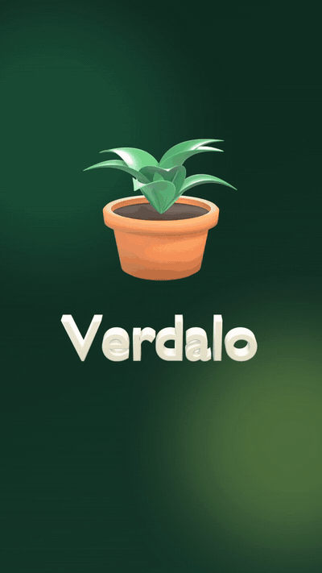
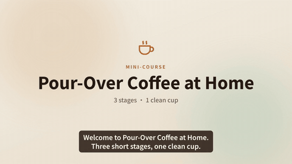
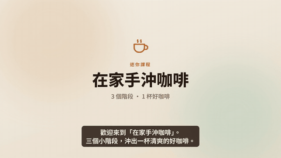
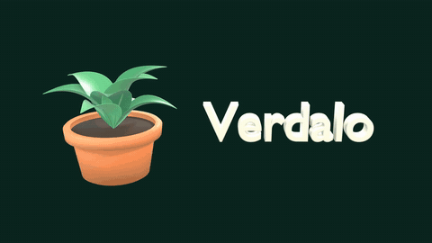

# Media Production Playbook

**English** | [繁體中文](README.zh-TW.md)

A reusable, CPU-friendly playbook for AI-assisted media production — narration with local TTS, automatic narration QA, narration-driven video with [Remotion](https://www.remotion.dev/), and optional 3D shots with [Blender](https://www.blender.org/). Built and tested on a modest Windows + WSL2 laptop (8 cores, no NVIDIA GPU), written to work on macOS too.

Highlights:

- **Taiwanese Mandarin and Taiwanese Hokkien (Taigi, 台語)** — local ASR with Breeze-ASR-25 (Mandarin + code-switching) and Breeze-ASR-26 (Taigi speech → Mandarin text), Taigi TTS with a GPT-SoVITS fork, Traditional-Chinese-aware QA. See [docs/playbooks/taiwanese-taigi.md](docs/playbooks/taiwanese-taigi.md).
- **Narration QA that catches what CER misses** — drags, repeats, rate outliers, relative naturalness.
- **Narration-driven video** with Remotion, plus optional Blender 3D shots — all CPU-friendly.
- **Beat-synced launch videos**: locally generated rhythmic music (ACE-Step + stems + procedural drums), one beat grid shared by music, edit and 3D animation. See [docs/playbooks/beat-synced-launch-video.md](docs/playbooks/beat-synced-launch-video.md).

It is three things at once:

- **Playbooks** (`docs/`) — what worked, what broke, and the checks that catch it.
- **Scripts** (`scripts/`) — portable tools: TTS, narration QA, rendering, loudness post-processing, Blender headless rendering.
- **Examples** (`examples/`) — complete productions you can re-render end to end, using only synthetic voices and fictional products.

## Examples

All voices are Kokoro's built-in synthetic voices — no real person's voice is used or cloned. Products and courses are fictional.

| Example | Format | English | 中文 (Traditional) |
|---|---|---|---|
| **Promo** — "Verdalo", a fictional plant-care app, with a Blender 3D opening | 9:16 · 26–30 s | [](https://github.com/osisdie/media-production-playbook/releases/download/v0.1.0/promo-demo-en.mp4)<br>male voice · [▶ mp4](https://github.com/osisdie/media-production-playbook/releases/download/v0.1.0/promo-demo-en.mp4) · [🔊 mp3](https://github.com/osisdie/media-production-playbook/releases/download/v0.1.0/promo-demo-en-vo.mp3) | [](https://github.com/osisdie/media-production-playbook/releases/download/v0.1.0/promo-demo-zh.mp4)<br>female voice · [▶ mp4](https://github.com/osisdie/media-production-playbook/releases/download/v0.1.0/promo-demo-zh.mp4) · [🔊 mp3](https://github.com/osisdie/media-production-playbook/releases/download/v0.1.0/promo-demo-zh-vo.mp3) |
| **Course intro** — "Pour-Over Coffee at Home", a fictional mini-course | 16:9 · ~42 s | [](https://github.com/osisdie/media-production-playbook/releases/download/v0.1.0/course-demo-en.mp4)<br>female voice · [▶ mp4](https://github.com/osisdie/media-production-playbook/releases/download/v0.1.0/course-demo-en.mp4) · [🔊 mp3](https://github.com/osisdie/media-production-playbook/releases/download/v0.1.0/course-demo-en-vo.mp3) | [](https://github.com/osisdie/media-production-playbook/releases/download/v0.1.0/course-demo-zh.mp4)<br>male voice · [▶ mp4](https://github.com/osisdie/media-production-playbook/releases/download/v0.1.0/course-demo-zh.mp4) · [🔊 mp3](https://github.com/osisdie/media-production-playbook/releases/download/v0.1.0/course-demo-zh-vo.mp3) |
| **3D turntable** — procedural Blender scene, no external assets | 16:9 loop · ~6 s | [](https://github.com/osisdie/media-production-playbook/releases/download/v0.1.0/blender-demo-16x9.mp4)<br>[▶ mp4](https://github.com/osisdie/media-production-playbook/releases/download/v0.1.0/blender-demo-16x9.mp4) | — |

GIFs are silent previews; click through for the full video with sound. All renders are attached to the [v0.1.0 release](https://github.com/osisdie/media-production-playbook/releases/tag/v0.1.0).

<!-- Inline players: GitHub only plays videos uploaded through its web editor (user-attachments URLs). Paste them below this line. -->

## Quick start

Requirements: Python 3.10–3.12, Node 18+, ffmpeg. Blender is optional. The first run downloads the Kokoro and faster-whisper models (set `SKIP_MODELS=1` to defer), and the first render downloads a headless Chrome (~100 MB) for Remotion.

<details open>
<summary><b>Windows (WSL2) / Linux</b></summary>

```bash
sudo apt install -y ffmpeg git
bash scripts/setup/setup-linux-wsl.sh
python3 scripts/setup/check_env.py
bash examples/course-demo/run.sh en      # synth → QA → render → post (no argument = both languages)
```
More: [docs/platform/windows-wsl.md](docs/platform/windows-wsl.md)
</details>

<details>
<summary><b>macOS</b></summary>

```bash
brew install ffmpeg node python@3.12
bash scripts/setup/setup-macos.sh
python3 scripts/setup/check_env.py
bash examples/course-demo/run.sh en
```
More: [docs/platform/macos.md](docs/platform/macos.md) — macOS is covered by CI; the bundled renders were made on WSL.
</details>

Outputs land in `examples/<example>/out/` (git-ignored). Each example's README lists its languages, options and **QA notes** (which lines were rewritten for the TTS voice, and why).

Useful tools:

```bash
node scripts/video/stills.mjs …                          # one still per shot — fast layout check
python3 scripts/video/check_output.py examples/*/out/*.mp4  # delivery spec + loudness, exits 1 on failure
python3 scripts/vo/verify.py examples/course-demo/project.zh.json   # narration QA → build/zh/QA.md
```

## What's inside

```
docs/playbooks/   voice-production · taiwanese-taigi · narration-qa · course-video · promo-video · blender-in-pipeline
                  · beat-synced-launch-video (3D + music + beat-grid editing, multi-agent orchestration)
docs/platform/    windows-wsl · macos · low-resource
docs/consent/     voice consent record template (before cloning anyone's voice)
skills/           the same knowledge as Claude Code skills (copy into ~/.claude/skills)
prompts/          TTS-friendly script writing · storyboard · QA review
scripts/tts/      Kokoro synthesis → per-line wav + timing.json
scripts/vo/       narration QA: verify (CER/WER, drag, rate, UTMOS), pick_takes, prosody (Praat PSOLA)
                  (a line can carry "qa_text" when the TTS text is a respelling, e.g. "Ver-dah-lo")
scripts/video/    Remotion render, ffmpeg loudness post, stills/contact sheet, preview GIFs
scripts/blender/  find Blender per OS, procedural scene, frames → alpha video
scripts/check/    private-term scan + pre-commit hook (gitleaks)
remotion/         one Remotion project: shared kit + example compositions
examples/         promo-demo · course-demo · blender-demo
models/           download notes and licenses (weights are never committed)
```

## Lessons baked in

- **CER is not "reads well".** TTS can stall, repeat or drag a syllable and still transcribe perfectly. `verify.py` also checks drags, speaking-rate outliers and relative naturalness, and writes a short "listen to these lines" list.
- **Check the file you ship.** Post-processing (pitch, EQ, loudness) can flip ASR results; QA runs on the final audio.
- **Pick takes with the same ruler as the final QA**, and synthesise more takes before reaching for audio processing.
- **Narration drives timing**: shot lengths come from the voice, not the other way round.
- **One heavy job at a time** on a CPU machine.

The playbooks are written in Traditional Chinese with English headings; platform notes and code comments are in English. Translations are welcome.

## Privacy & safety

- No real voices: examples use synthetic voices only. Cloning is documented for **consented** voices, and reference audio is git-ignored.
- `scripts/check/install-hooks.sh` installs a pre-commit hook running gitleaks and a private-term scan driven by a local, git-ignored `.private-denylist`.
- Mock screens never show real accounts, prices or keys.

## Licenses

- Code: [MIT](LICENSE). Docs, prompts and skills: [CC BY 4.0](LICENSE-docs).
- Third-party tools keep their own licenses: Kokoro-82M (Apache-2.0), faster-whisper (MIT), Blender (GPL — invoked as an external tool only). **Remotion is not MIT**: it is free for individuals and small teams, but companies above its threshold need a company license — see [remotion.dev/license](https://www.remotion.dev/license).
- See [models/README.md](models/README.md) for every model that gets downloaded.

## Contributing

Issues and PRs are welcome — new playbooks (marketing, podcasts, other languages), portability fixes, and better checks. See [CONTRIBUTING.md](CONTRIBUTING.md).
