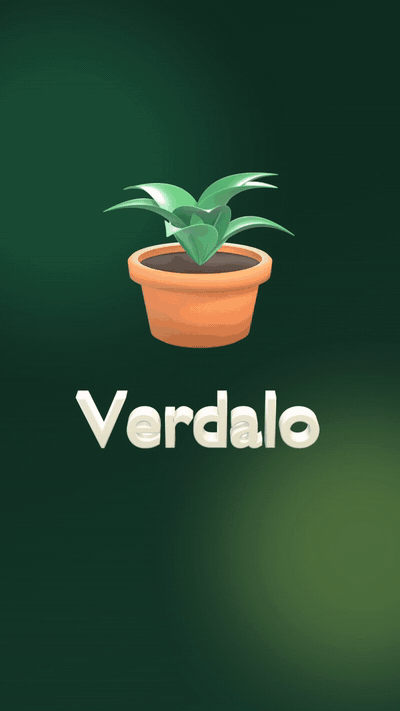
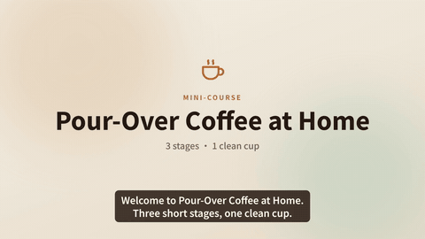
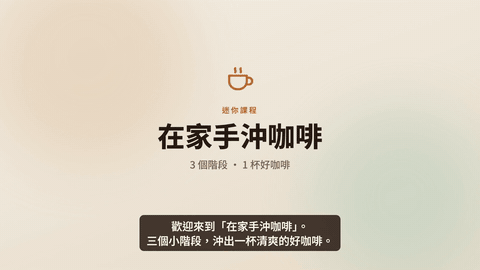
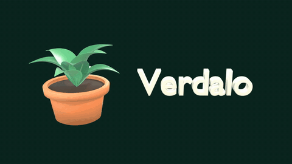

# Media Production Playbook（影音製作經驗庫）

[English](README.md) | **繁體中文**

一套可重複使用、CPU 就跑得動的 AI 影音製作經驗庫：本機 TTS 旁白、旁白自動品管、由旁白驅動時間軸的 [Remotion](https://www.remotion.dev/) 影片，以及選用的 [Blender](https://www.blender.org/) 3D 鏡頭。在一台普通的 Windows＋WSL2 筆電（8 核、沒有 NVIDIA 顯示卡）上實作與測試，也考慮了 macOS。

重點功能：

- **台灣華語與台語**：本機語音辨識用 Breeze-ASR-25（華語＋中英夾雜）和 Breeze-ASR-26（台語語音 → 華語文字）；台語 TTS 用 GPT-SoVITS 的台語 fork；品管會處理繁簡與數字寫法。見 [docs/playbooks/taiwanese-taigi.md](docs/playbooks/taiwanese-taigi.md)。
- **抓得到 CER 漏掉問題的旁白品管**：拖音、重複、語速離群、相對自然度。
- **行銷審查關卡**：技術 QA 全過、產品卻看起來廉價或詭異——用創意總監視角的清單（開頭鉤子、吸引力、文案與畫面一致、品牌色實測）在正式 render 前審試渲。見 [docs/playbooks/marketing-review.md](docs/playbooks/marketing-review.md)。
- **由旁白驅動的影片**：Remotion，加上選用的 Blender 3D 鏡頭，CPU 就跑得動。
- **踩在拍上的產品發表片**：本機生成節奏型配樂（ACE-Step＋分軌＋程式鼓組），配樂、剪接、3D 動畫共用同一條節拍格線。見 [docs/playbooks/beat-synced-launch-video.md](docs/playbooks/beat-synced-launch-video.md)。
- **只用本機開源模型做擬真 AI 歌詞 MV**：在 6 GB 筆電 GPU 上實測 SDXL／FLUX 關鍵畫面、IP-Adapter 角色一致、FramePack 與 LTX 圖生影片、ACE-Step 中文人聲作曲，附授權注意事項和一晚的產能估算。見 [docs/playbooks/local-ai-music-video.md](docs/playbooks/local-ai-music-video.md)。

它同時是三樣東西：

- **經驗文件**（`docs/`）：哪些做法有效、哪裡會壞，以及抓得到問題的檢查。
- **腳本**（`scripts/`）：跨平台工具，包括 TTS、旁白品管、渲染、響度後製、Blender 無頭渲染。
- **範例**（`examples/`）：可以從頭重新 render 的完整作品，只用合成聲音和虛構的產品。

## 範例

所有聲音都是 Kokoro 內建的合成聲音，沒有使用或 clone 任何真人的聲音；產品和課程都是虛構的。

| 範例 | 規格 | English | 中文 |
|---|---|---|---|
| **宣傳片**：虛構的植物照護 App「Verdalo」，開場是 Blender 3D 鏡頭 | 9:16・26–30 秒 | [](https://github.com/osisdie/media-production-playbook/releases/download/v0.1.0/promo-demo-en.mp4)<br>男聲・[▶ mp4](https://github.com/osisdie/media-production-playbook/releases/download/v0.1.0/promo-demo-en.mp4)・[🔊 mp3](https://github.com/osisdie/media-production-playbook/releases/download/v0.1.0/promo-demo-en-vo.mp3) | [](https://github.com/osisdie/media-production-playbook/releases/download/v0.1.0/promo-demo-zh.mp4)<br>女聲・[▶ mp4](https://github.com/osisdie/media-production-playbook/releases/download/v0.1.0/promo-demo-zh.mp4)・[🔊 mp3](https://github.com/osisdie/media-production-playbook/releases/download/v0.1.0/promo-demo-zh-vo.mp3) |
| **課程簡介**：虛構的迷你課程「在家手沖咖啡」 | 16:9・約 42 秒 | [](https://github.com/osisdie/media-production-playbook/releases/download/v0.1.0/course-demo-en.mp4)<br>女聲・[▶ mp4](https://github.com/osisdie/media-production-playbook/releases/download/v0.1.0/course-demo-en.mp4)・[🔊 mp3](https://github.com/osisdie/media-production-playbook/releases/download/v0.1.0/course-demo-en-vo.mp3) | [](https://github.com/osisdie/media-production-playbook/releases/download/v0.1.0/course-demo-zh.mp4)<br>男聲・[▶ mp4](https://github.com/osisdie/media-production-playbook/releases/download/v0.1.0/course-demo-zh.mp4)・[🔊 mp3](https://github.com/osisdie/media-production-playbook/releases/download/v0.1.0/course-demo-zh-vo.mp3) |
| **3D 轉台**：程序產生的 Blender 場景，不用任何外部素材 | 16:9 循環・約 6 秒 | [](https://github.com/osisdie/media-production-playbook/releases/download/v0.1.0/blender-demo-16x9.mp4)<br>[▶ mp4](https://github.com/osisdie/media-production-playbook/releases/download/v0.1.0/blender-demo-16x9.mp4) | — |

GIF 是無聲預覽，點進去可以看有聲音的完整影片。所有成品都放在 [v0.1.0 release](https://github.com/osisdie/media-production-playbook/releases/tag/v0.1.0)。

## 快速開始

需要：Python 3.10–3.12、Node 18 以上、ffmpeg。Blender 是選用的。第一次執行會下載 Kokoro 和 faster-whisper 模型（設 `SKIP_MODELS=1` 可以延後），第一次 render 會下載 Remotion 用的 headless Chrome（約 100 MB）。

<details open>
<summary><b>Windows（WSL2）／Linux</b></summary>

```bash
sudo apt install -y ffmpeg git
bash scripts/setup/setup-linux-wsl.sh
python3 scripts/setup/check_env.py
bash examples/course-demo/run.sh zh      # 合成 → 品管 → render → 後製（不帶參數＝兩種語言都做）
```
更多：[docs/platform/windows-wsl.md](docs/platform/windows-wsl.md)
</details>

<details>
<summary><b>macOS</b></summary>

```bash
brew install ffmpeg node python@3.12
bash scripts/setup/setup-macos.sh
python3 scripts/setup/check_env.py
bash examples/course-demo/run.sh zh
```
更多：[docs/platform/macos.md](docs/platform/macos.md)。macOS 由 CI 驗證；repo 附的成品是在 WSL 上做的。
</details>

成品會輸出到 `examples/<example>/out/`（已被 gitignore）。每個範例的 README 寫了它支援的語言、選項和 **QA notes**（哪些句子為了 TTS 改寫過、為什麼）。

常用工具：

```bash
node scripts/video/stills.mjs …                          # 每顆鏡頭一張靜態圖，快速檢查版面
python3 scripts/video/check_output.py examples/*/out/*.mp4  # 交付規格＋響度，不合格時 exit 1
python3 scripts/vo/verify.py examples/course-demo/project.zh.json   # 旁白品管 → build/zh/QA.md
```

## 內容

```
docs/playbooks/   聲音製作・台語 TTS 與 ASR・旁白品管・課程片・宣傳片・行銷審查・Blender 進管線
                  ・有節奏感的 3D 發表片（配樂＋節拍剪輯＋多 agent 協調）
                  ・本機 AI 歌詞 MV（關鍵畫面 → 圖生影片 → 含人聲作曲 → 動態歌詞，6 GB GPU）
docs/platform/    Windows WSL・macOS・低資源機器
docs/consent/     聲音同意紀錄範本（clone 任何人的聲音之前）
skills/           同樣的知識，做成 Claude Code skill（複製到 ~/.claude/skills）
prompts/          TTS 友善的寫稿・分鏡・品管檢討提示詞
scripts/tts/      Kokoro 合成 → 每句 wav＋timing.json
scripts/vo/       旁白品管：verify（CER/WER、拖音、語速、UTMOS）、pick_takes、prosody（Praat PSOLA）
                  （TTS 文字用了改寫拼法時，例如「Ver-dah-lo」，該句可以加 "qa_text"）
scripts/video/    Remotion render、ffmpeg 響度後製、抽幀／contact sheet、預覽 GIF
scripts/blender/  依 OS 找 Blender、程序產生場景、影格 → 透明背景影片
scripts/check/    私有詞掃描＋pre-commit hook（gitleaks）
remotion/         一個 Remotion 專案：共用元件＋範例 composition
examples/         promo-demo・course-demo・blender-demo
models/           模型下載說明與授權（權重檔永遠不進 git）
```

## 內建的經驗

- **CER 不等於「念得好」。** TTS 可能卡住、重複或拖長某個音，ASR 卻照樣轉寫正確。`verify.py` 另外檢查拖音、語速離群和相對自然度，並產生一份簡短的「重點試聽清單」。
- **檢查要出貨的那個檔案。** 後處理（音高、EQ、響度）可能讓 ASR 結果翻盤，所以品管在最終音檔上跑。
- **挑 take 和最終品管用同一把尺**；候選都不乾淨時，先多合成幾個 take，再考慮調音訊處理。
- **由旁白決定時間軸**：鏡頭長度跟著聲音走，不是反過來硬塞。
- **CPU 機器一次只跑一個重工作。**

經驗文件（playbooks）以繁體中文撰寫、標題附英文；平台說明和程式註解用英文。歡迎協助翻譯。

## 隱私與安全

- 不使用真人聲音：範例只用合成聲音。文件裡的 clone 流程只適用於**取得同意**的聲音，參考音檔一律被 gitignore。
- `scripts/check/install-hooks.sh` 會安裝 pre-commit hook，執行 gitleaks 和私有詞掃描；私有詞清單放在本機、不進 git 的 `.private-denylist`。
- 模擬畫面不出現真實帳號、價格或金鑰。

## 授權

- 程式碼：[MIT](LICENSE)；文件、提示詞與 skills：[CC BY 4.0](LICENSE-docs)。
- 第三方工具各自保留授權：Kokoro-82M（Apache-2.0）、faster-whisper（MIT）、Blender（GPL，只當外部工具呼叫）。**Remotion 不是 MIT**：個人和小團隊免費，公司超過門檻需要購買授權，詳見 [remotion.dev/license](https://www.remotion.dev/license)。
- 會下載的所有模型列在 [models/README.md](models/README.md)。

## 參與貢獻

歡迎開 issue 和 PR：新的經驗文件（行銷、Podcast、其他語言）、跨平台修正、更好的檢查。見 [CONTRIBUTING.md](CONTRIBUTING.md)。
